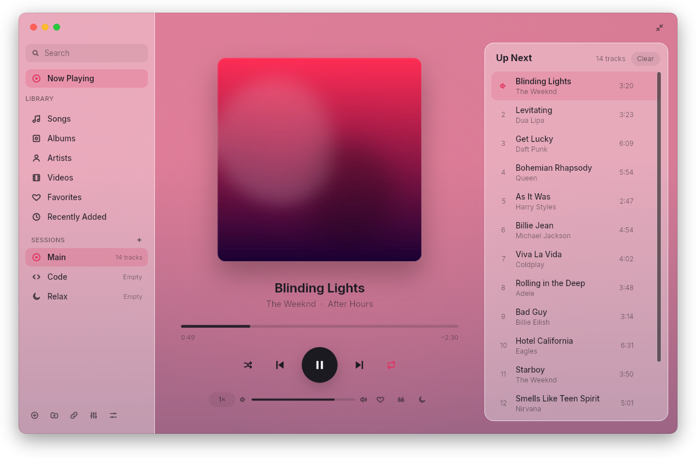
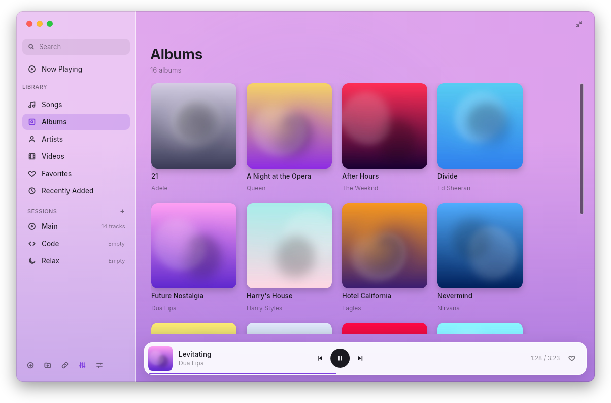
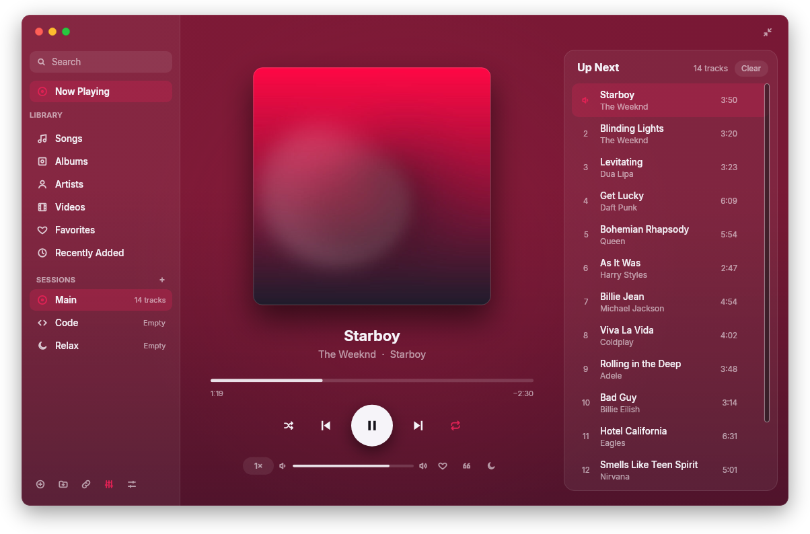
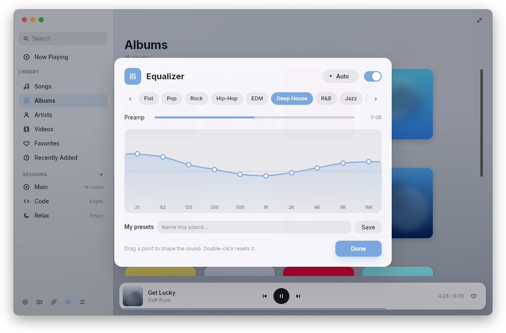
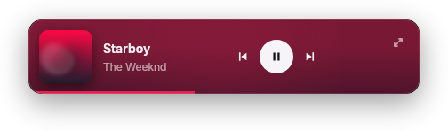

# یونیسون پلیر

[English](README.md) · **فارسی**

پلیر موسیقی و ویدیو با رابط شیشه‌ای و آرام، نوشته‌شده با Rust، همراه با
**ترجمهٔ آفلاین زیرنویس انگلیسی به فارسی**. رابط با Slint ساخته شده، پخش با
libmpv انجام می‌شود و یک مدل ترجمهٔ موزیلا که همراه برنامه است زیرنویس را روی
همین کامپیوتر ترجمه می‌کند؛ بدون اینترنت، سرور یا پایتون.

  

  
  

  
  

## دریافت

فایل‌ها در صفحهٔ [Releases](https://github.com/Nahur1/unison/releases/latest) هستند:

| سیستم | فایل |
| --- | --- |
| **ویندوز** ۱۰ و ۱۱ | `unison-setup-VERSION.exe` |
| **مک** Apple Silicon (macOS 15+) | `unison-VERSION-macos-arm64.dmg` |
| **مک** Intel (macOS 15+) | `unison-VERSION-macos-x86_64.dmg` |
| **دبیان / اوبونتو / مینت** | `unison-VERSION-linux-amd64.deb` |

- **لینوکس:** `sudo apt install ./unison-VERSION-linux-amd64.deb` — با libmpv2
  (دبیان ۱۳، اوبونتو ۲۴.۰۴ به بعد) و libmpv1 (اوبونتو ۲۲.۰۴) کار می‌کند.
- **مک:** برنامه را به Applications بکشید. بار اول روی آن راست‌کلیک کنید و **Open**
  را بزنید، یا از Privacy & Security اجازه بدهید.
- **به‌روزرسانی:** نسخهٔ نصب‌شدهٔ ویندوز خودش نسخهٔ جدید را می‌گیرد و موقع خروج
  نصب می‌کند. در مک و لینوکس، یونیسون نسخهٔ جدید را خبر می‌دهد و دکمهٔ
  **Download** صفحهٔ دانلود را باز می‌کند.

## زیرنویس فارسی

ویدیوی انگلیسی با زیرنویس را باز کنید؛ ترجمهٔ فارسی جمله‌به‌جمله و زنده زیر آن
نمایش داده می‌شود.

- سه حالت: **اصلی**، **دوزبانه** و **فارسی** — با کلید **T** عوض می‌شود.
- جمله‌هایی که در چند خط زیرنویس پخش شده‌اند با هم ترجمه می‌شوند و خط‌های بعدی
  از قبل آماده می‌شوند.
- اندازه و جای متن قابل تنظیم است و از فونت وزیرمتن استفاده می‌کند.
- با **Export** یک فایل `.srt` فارسی کنار ویدیو ذخیره می‌شود.

## امکانات دیگر

- **کتابخانهٔ موسیقی:** آهنگ‌ها، آلبوم‌ها، هنرمندها، ویدیوها، علاقه‌مندی‌ها و جستجو.
- **سشن‌ها:** هر سشن فهرست، جای پخش، صدا و پوشه‌های خودش را دارد.
- **متن آهنگ** (Y)، **اکولایزر** ۱۰ باندی با حالت خودکار (E)، تایمر خواب، سرعت
  پخش، تکرار A-B و یادداشت روی ویدیو.
- **مینی‌پلیر** همیشه‌رو و تصویر در تصویر برای ویدیو.
- **کنترل از ترمینال:** `unison toggle`، `unison next`، `unison mute`،
  `unison status` و بقیه (`unison --help`).

## آیکون کنار ساعت (تری)

- **بستن پنجره** برنامه را نمی‌بندد: اگر آهنگی در حال پخش باشد، پنجره به
  پخش‌کنندهٔ کوچک (مینی‌پلیر) تبدیل می‌شود تا معلوم باشد Unison در حال اجراست.
  بستن مینی‌پلیر (یا پنجره وقتی چیزی پخش نمی‌شود) برنامه را کنار ساعت نگه
  می‌دارد و ویدیو مکث می‌شود. با کلیک روی آیکون، پنجره برمی‌گردد.
- **Quit** از منوی آیکون، یا `unison close`، پخش را متوقف می‌کند و برنامه را
  کامل می‌بندد.
- در گنوم ساده آیکون فقط با افزونهٔ AppIndicator نشان داده می‌شود؛ بدون آن،
  بستن پنجره برنامه را می‌بندد.

## ساخت از سورس

راهنمای کامل ساخت و تست در [README انگلیسی](README.md#build-from-source) و
[CONTRIBUTING.md](CONTRIBUTING.md) آمده است.

## تیم پروژه

هر دو نفر نویسنده و نگه‌دارندهٔ پروژه هستند:

- **رضا هاشمیان** ([@reza-hashemian](https://github.com/reza-hashemian)) — نویسندهٔ
  Nava، پلیری که یونیسون بر پایهٔ آن ساخته شده.
- **محمد فخاری** ([@Nahur1](https://github.com/Nahur1)) — زیرنویس فارسی آفلاین،
  بسته‌سازی و نسخهٔ یونیسون.

## نسخهٔ موبایل

کد اندروید و PWA آیفون در پوشهٔ `mobile` قرار دارد. راهنمای نصب، قابلیت‌ها،
تفاوت با نسخهٔ دسکتاپ و تست‌ها در [راهنمای موبایل](docs/MOBILE.md) آمده است.
خروجی APK امضاشده و PWA پس از تأیید PR و موفقیت اکشن‌ها ساخته و منتشر می‌شود.

## مجوز

[LICENSE](LICENSE) و [COPYRIGHT.md](COPYRIGHT.md) را ببینید. بخش‌هایی که قبلاً با
مجوز MIT منتشر شده‌اند همچنان MIT هستند.

