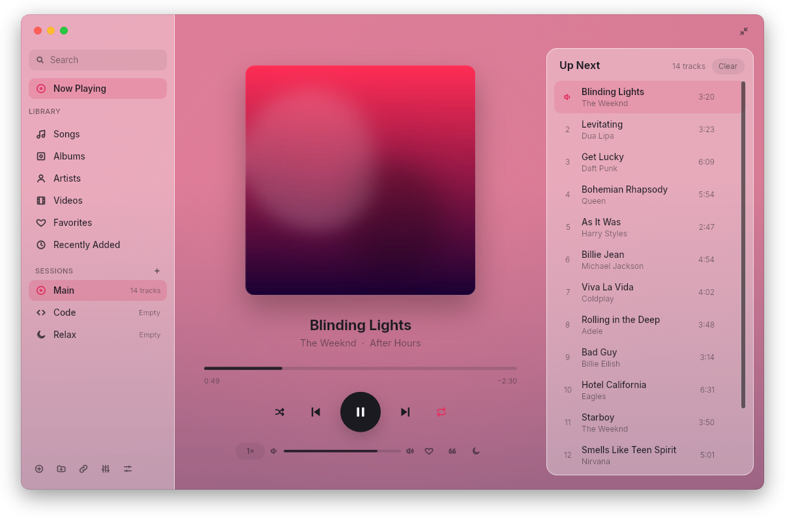
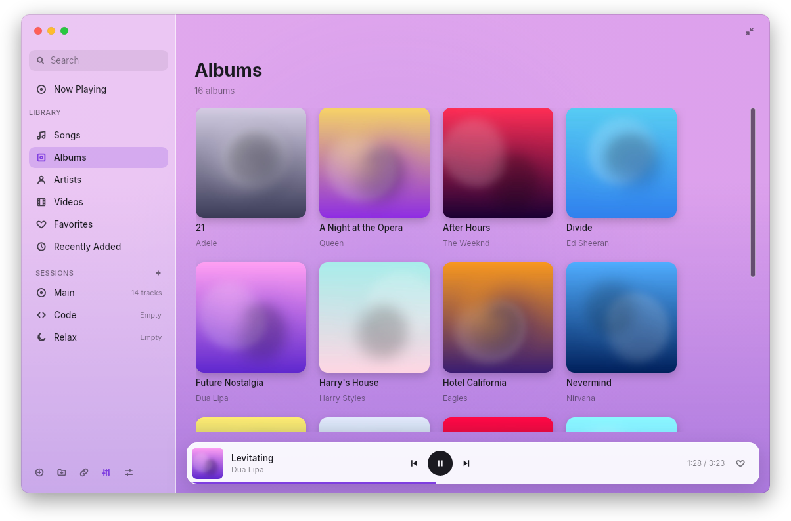
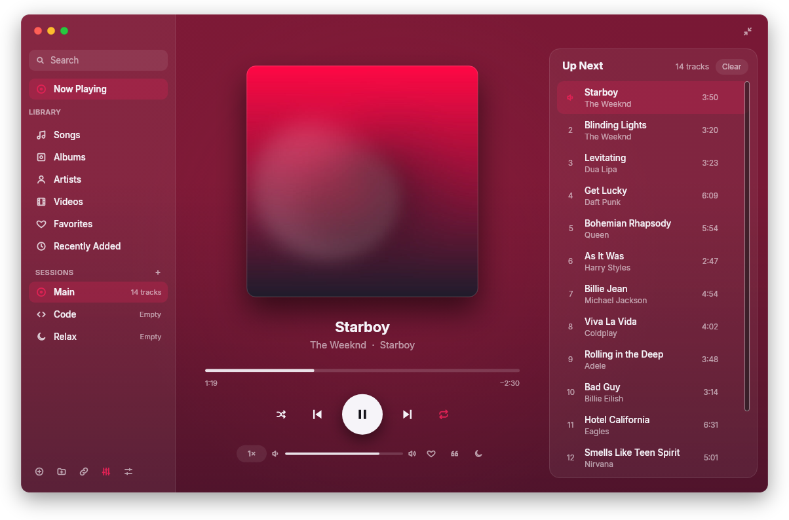
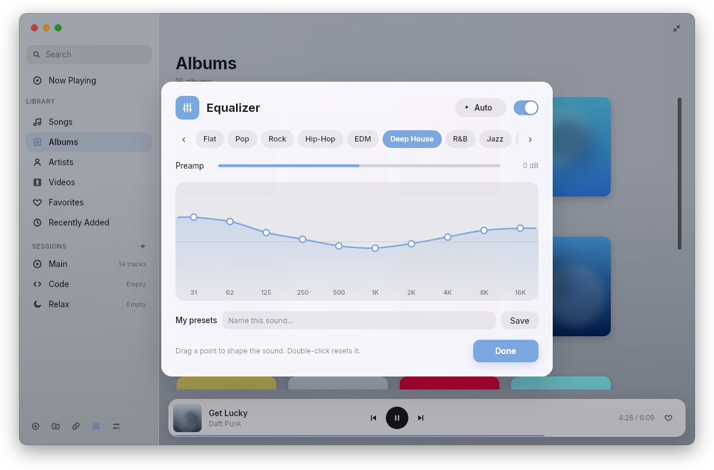
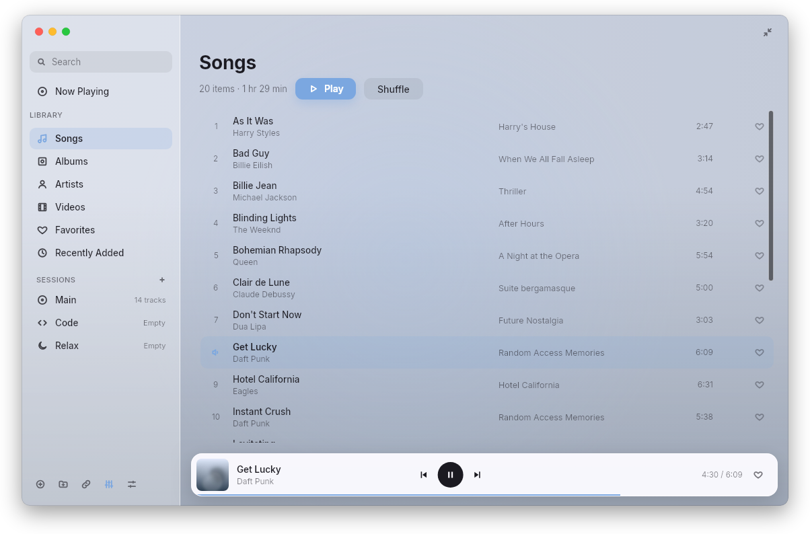
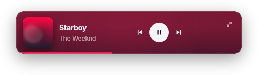

# Unison Player

**English** · [فارسی](README.fa.md)

A calm, glassy music and video player written in Rust, with live **offline
English-to-Persian subtitles**. Slint draws the interface, libmpv plays the
media, and a bundled Mozilla model translates subtitles on your own computer:
no internet, server or Python needed.

<p align="center">
  
</p>
<p align="center">
  
  
</p>
<p align="center">
  
  
</p>
<p align="center">
  
</p>

<sub>Screenshots use made-up sample data.</sub>

## Download

| System | File on [Releases](https://github.com/Nahur1/unison/releases/latest) |
| --- | --- |
| **Windows** 10/11 (x64) | `unison-setup-VERSION.exe` |
| **macOS 15+** Apple Silicon | `unison-VERSION-macos-arm64.dmg` |
| **macOS 15+** Intel | `unison-VERSION-macos-x86_64.dmg` |
| **Debian / Ubuntu / Mint** (amd64) | `unison-VERSION-linux-amd64.deb` |

- **Linux:** `sudo apt install ./unison-VERSION-linux-amd64.deb`. Works with
  libmpv2 (Debian 13, Ubuntu 24.04+) and libmpv1 (Ubuntu 22.04).
- **macOS:** drag **Unison Player** to Applications. The app isn't notarized by
  Apple; the first time, right-click it → **Open**, or allow it in
  Privacy & Security.
- **Windows:** SmartScreen may warn about an unknown publisher:
  **More info → Run anyway**.
- **Updates:** the installed Windows app downloads new versions itself and
  installs them when you quit. On macOS and Linux, Unison checks for a new
  version and shows a dot on the ↑ button; **Download** opens the release page.
- [FFmpeg](https://ffmpeg.org) is optional (it reads embedded subtitles ahead
  of time). [yt-dlp](https://github.com/yt-dlp/yt-dlp) is needed only for links.

## Persian subtitles

Play an English video with subtitles and Unison shows a natural Persian line
under it, translated live, sentence by sentence.

- Three modes: **Original**, **Bilingual** and **Persian**. Press **T** to switch.
- Sentences split across several cues are translated together, and the next
  lines are translated ahead, so the Persian text keeps up with the video.
- The line stays on screen across short gaps inside a sentence.
- Size and position are adjustable; the text uses the bundled Vazirmatn font.
- **Export** saves a Persian `.srt` next to the video.

The translation model (22 MB, Mozilla's Firefox Translations, `en→fa`) ships
inside every package.

## Video

Videos play in the same window: the picture fills it and glass controls float
on top, fading out when the mouse stops. In the mini player a video becomes a
small always-on-top picture-in-picture window.

- Each video remembers where you stopped (cleared when you finish it).
- Subtitle and audio-track menus, speed control, fullscreen (F or double-click).
- `.` and `,` step one frame forward or back while paused.
- Old Persian `.srt` files in Windows-1256 are detected and read correctly.
- "‹ Library" (or V) shows the library while the video keeps playing.

## Music library

Add the folders where you keep music and videos (⊕ at the bottom of the
sidebar). Unison indexes them in the background and checks for new files every
ten minutes.

- Songs, Albums (a cover grid), Artists, Videos, Favorites, Recently Added
- Search as you type across titles, artists, albums and file names
- Colours follow the artwork, or pick a fixed theme in Settings
- Right-click a song for **Play Next**, **Show in Folder** and **Move to Trash**

**Sessions:** Main, Code and Relax are always there, and + makes your own. Each
session keeps its own list, position, volume and library folders.

**Lyrics** (Y): a `.lrc` file next to the song, lyrics in its tags, or
[LRCLIB](https://lrclib.net) online. Timed lyrics follow the song; click a line
to jump there.

**Equalizer** (E): 10 bands, 19 presets, a preamp and your own presets.
**Auto** picks a preset for every song from its genre or the file itself.

**Listening tools:** sleep timer (fades out, or stops at the end of the track),
speed from 0.5× to 2× remembered per folder, A-B loop (A), and notes on videos
(B) that export to Markdown.

Music pauses when the screen locks and resumes when you unlock (GNOME and KDE).

## Tray

On Windows, macOS, KDE and Ubuntu, Unison has a tray / menu-bar icon with
play/pause, next, previous, mini player, show and **Quit**.

- **Closing the window** keeps the music playing in the tray (a playing video
  pauses). Click the tray icon to bring the window back.
- **Quit** in the tray menu, or `unison close`, stops playback and exits
  completely.

Plain GNOME shows tray icons only with the AppIndicator extension
(`gnome-shell-extension-appindicator`). Without a tray, closing the window quits.

## Terminal and Code mode

`unison --code` opens the Code session in a small always-on-top mini player and
starts playing where you left off. If Unison is already open, every command goes
to that window instead of starting a second one.

```sh
unison                         # open the last session
unison "/path/to/movie.mp4"    # play files, folders or links
unison toggle | play | pause | next | prev | mute
unison mini | full | fullscreen | show
unison sleep 30 | end | off
unison speed 1.25
unison mark "closures explained here"
unison status --format "{state} {title} · {pos}/{dur}"
unison close                   # stop playback and exit
unison --help
```

`status` prints nothing (exit code 1) when Unison isn't running, so it's safe in
a shell prompt.

Global shortcuts (X11, Windows, macOS): **Ctrl+Alt+Space** play/pause,
**Ctrl+Alt+.** next, **Ctrl+Alt+,** previous, **Ctrl+Alt+M** mini player.
Media keys work through MPRIS on Linux and the system media controls on
macOS and Windows.

## Keys in the window

| Key | Action |
| --- | --- |
| Space | Play / pause |
| ← / → | Seek 5 s |
| ↑ / ↓ | Volume |
| N / P | Next / previous |
| T | Subtitle mode: original, bilingual, Persian (video) |
| . / , | Next / previous frame (video) |
| F | Fullscreen (video) |
| V | Switch between the video and the library |
| L | Favourite the current song |
| Y | Lyrics |
| E | Equalizer |
| A | A-B loop: mark A, mark B, clear |
| B | Notes panel (video) |
| Ctrl+O | Open a folder |
| Ctrl+L | Play a link |
| Ctrl+M | Mini player / full window |
| Ctrl+, | Settings |
| Delete | Move the playing song to the Trash (asks first) |
| Esc | Leave fullscreen / close a sheet / go back |

## Build from source

Needs Rust (stable) and libmpv development files.

```sh
# Debian / Ubuntu
sudo apt install libmpv-dev
python3 scripts/prepare-offline.py   # fetches and verifies the translation model
cargo test --locked
cargo run --release
python3 scripts/package-unix.py linux    # or: macos
```

- **macOS:** `brew install mpv dylibbundler`, then set `MPV_LIB_DIR` to
  Homebrew's mpv `lib` folder.
- **Windows:** MSVC and the Windows SDK; put `libmpv-2.dll` in `runtime/`, then
  `./scripts/build.ps1 -Test` and `./scripts/release.ps1`.

Every push and pull request runs native tests on Windows, Linux, Apple Silicon
and Intel Macs. A new version on `main` is published only after all of them
pass. See [CONTRIBUTING.md](CONTRIBUTING.md) and
[docs/CROSS_PLATFORM.md](docs/CROSS_PLATFORM.md).

For testing, `UNISON_PROFILE_DIR`, `UNISON_SOCKET` and `UNISON_IPC_PORT` keep a
second copy apart from the one you use; `UNISON_AO=null` runs silently and
`UNISON_MPV_LOG=1` prints mpv's log.

## Project team

Both are authors and maintainers:

- **Reza Hashemian** ([@reza-hashemian](https://github.com/reza-hashemian)):
  wrote Nava, the player Unison is built on.
- **Mohammad Fakhari** ([@Nahur1](https://github.com/Nahur1)): offline Persian
  subtitles, packaging and the Unison edition.

Only these two accounts author commits here; see
[CONTRIBUTING.md](CONTRIBUTING.md).

## Mobile application

Android and iPhone PWA sources are in `mobile/`. See [mobile features, installation,
builds and test limits](docs/MOBILE.md). The Android APK and PWA ZIP are built
by GitHub Actions; signed releases and Pages deployment follow a reviewed merge.

## License

See [LICENSE](LICENSE) and [COPYRIGHT.md](COPYRIGHT.md). Earlier MIT material
stays under MIT ([licenses/LEGACY-MIT.txt](licenses/LEGACY-MIT.txt)); bundled
components keep their own licenses ([THIRD_PARTY.md](THIRD_PARTY.md)).
